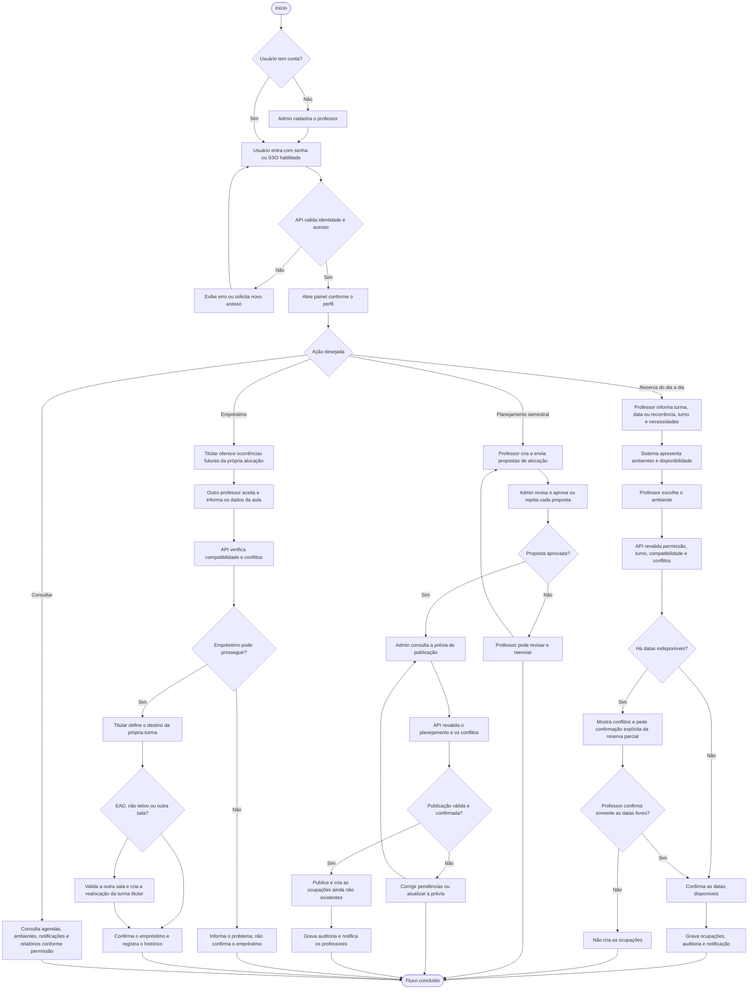

# Como funciona o SalaGest

O SalaGest organiza o uso de ambientes por professores e pela administração. O sistema não cria automaticamente a grade escolar: a instituição define os dias e turnos das turmas, e o SalaGest ajuda a distribuir salas, registrar reservas e acompanhar alterações.

## Visão geral

1. **Acesso:** o usuário entra com sua conta. O cadastro de professores é feito por um Admin. Se o acesso institucional (SSO) estiver habilitado, também é possível entrar por esse provedor.
2. **Preparação dos dados:** a administração mantém ambientes e seus recursos, turnos, semestres, turmas e informações pedagógicas. Professores e atribuições vinculam docentes às aulas; habilitação docente é um dado separado e não cria uma aula.
3. **Escolha do trabalho:** depois de entrar, o usuário consulta agendas e pode fazer uma reserva direta, enviar uma proposta de planejamento semestral ou participar de um empréstimo de ambiente.
4. **Validação e registro:** a API verifica identidade, permissão, dados, compatibilidade e conflitos antes de gravar no SQL Server. As operações relevantes mantêm histórico de auditoria e podem gerar notificações.

## Fluxograma principal

## Dois processos que não devem ser confundidos

- **Reserva cotidiana:** o professor escolhe uma sala e confirma diretamente. Não exige aprovação administrativa de rotina. Se uma recorrência tiver conflitos, o sistema informa as datas afetadas; reservar somente as datas livres exige confirmação explícita.
- **Planejamento semestral:** o professor envia propostas; o Admin decide e, depois, consulta a prévia e publica. Aprovar uma proposta não ocupa a sala por si só: as ocupações são criadas na publicação, após nova validação.

## Empréstimos

O titular oferece datas/turnos que já estão em sua alocação; o destinatário precisa aceitar e informar as necessidades da aula. Em seguida, o titular informa se sua própria turma ficará em EAD, não letivo ou será realocada para outra sala. O sistema registra a operação e verifica conflitos; EAD ou não letivo, por si só, não libera automaticamente uma sala.

## Onde acontece cada parte

- **Frontend (React):** telas, formulários, navegação e apresentação dos dados.
- **API (ASP.NET Core):** autenticação, autorização por perfil e validação das regras de negócio.
- **Banco (SQL Server):** usuários, turmas, ambientes, propostas, reservas/ocupações, empréstimos e histórico.

As verificações decisivas acontecem na API, mesmo quando a interface já mostra disponibilidade ou recomendações. Assim, conflitos ou alterações simultâneas são verificados novamente antes de confirmar e gravar.
